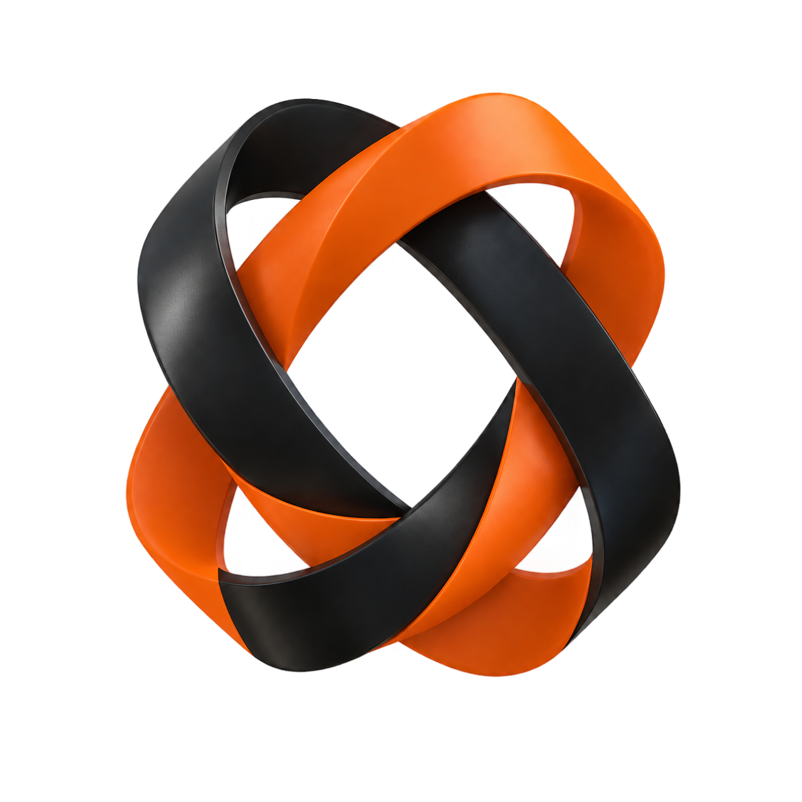

<div align="center">

</div>

# oxide-fw-cache

**Three-tier caching with single-flight coalescing and tag invalidation.**

[](https://crates.io/crates/oxide-fw-cache) [](https://crates.io/crates/oxide-fw-cache) [](https://docs.rs/oxide-fw-cache) [](https://github.com/elcoosp/oxide#rust-version)
[](https://github.com/elcoosp/oxide#license) [](https://github.com/elcoosp/oxide/actions) [](https://crates.io/crates/oxide-fw-cache)

> **Note:** Part of [Oxide](https://github.com/elcoosp/oxide) — a framework-agnostic, full-stack meta-framework with a Rust core and TypeScript authoring.

## Overview

The layer between a request and a re-render. Oxide's cache is tiered: L0 for full responses (no JS on hit), L1 for loader data (via `'use cache'`), L2 for outbound fetch memoization. Each tier supports memory, disk, Redis, S3, and HTTP backends.

Concurrent misses for the same key run one render — the rest await the result (single-flight). Tag and path invalidation drop entries precisely, not by clearing the whole cache.

## What it provides

- **`CacheHandler` trait** — uniform interface across every backend
- **`TieredCache`** — L0 + L1 + optional remote, sharing one handler
- **`SingleFlight`** — concurrent misses for the same key run one render
- **`CacheKey::canonical_parts`** — stable, prefix-free cache keys
- **`key_of` / `KeyStr`** (V2-B05) — the same 128-bit digest built on the stack (no `String`, no heap) for hot L0 lookups
- **O(1) tag index** (V2-B05) — `HashSet` tag sets plus a key→tags reverse index: idempotent inserts, eager cleanup on `delete`, stale memberships dropped on re-`set`
- **Disk-tier tag multimap** (V2-B06) — tags live in a redb multimap (set-valued, one insert per membership) with a one-time v1 → v2 migration on open
- **Tag and path invalidation** — `invalidate_tag`, `invalidate_path`
- **Stale-while-revalidate and stale-if-error** — configurable policy windows
- **Nonce sentinel handling** — a cached body serves any request without leaking another request's CSP nonce
- **Observability seams** (F28, F30, F31, F34, F35) — the push channel beside the `stats()` pull channel: one infallible callback per completed cache event (`CacheObserver`), with the in-crate consumers the §20 doc names — `TracingCacheObserver` (rows under the `oxide::cache` target), `MetricsCacheObserver` (the `oxide_cache_plane_*` Prometheus exposition), and `EventFeed` (a bounded lossy FIFO the host drains off the hot path, with the F35 admission gate — `FeedGate`/`AdmitAll`/`KindGate` narrow the intake before the owned row is built, rejections counted as admission, never as drops). The consumers compose behind the one `with_observer` slot through `FanoutCacheObserver` (F34 — one event into every child, construction order, the borrowed event re-shared). The seams have a production consumer since F36/F37: the CLI's serve boot attaches the exporter over the boot's tier and the render stage's flight owner records the publish count through `record_coalesced`, so the `oxide_cache_plane_*` families join the `/_oxide/metrics` scrape and the coalesce counter carries real L0 traffic (`crates/cache/examples/boot_posture.rs` walks the whole wire in one run)
- **The ledger's admission gate** (F39) — `HotKeyGate` + `AdmitAllKeys` +
  `HotKeyKindGate::only` + `with_gate`/`gated`: the F35 filter-surface shape
  transposed from the feed to the attribution ledger — the gate sees the
  borrowed event before the ledger lock, a rejected row allocates nothing
  and never counts in `unattributed()`, and the bound composes behind the
  gate unchanged
- **Hot-key attribution** (F38) — `HotKeyObserver` (`hot_keys.rs`) — the bounded per-key event ledger the dashboard-batcher shape names: every completed event attributes one count to its key whatever the op, admission is first-sight (resident keys count past the bound; arriving past-bound rows are unattributed and scored in `unattributed()` — the first refusal one sticky warn), `top(n)` is the deterministic read (count desc, key asc on ties), `reset()` starts a fresh window, and `render_prometheus(n)` renders the labeled `oxide_cache_plane_hot_key_total` counter family over the top window. The ledger has a production consumer since F40 — the CLI's boot attaches it beside the exporter behind the F34 fan and the §20 scrape renders its labeled family through `cache_plane_scrape` — and since F41 that scrape's top-n is operator-tunable: the boot resolves the `OXIDE_CACHE_PLANE_HOT_KEY_TOP` spelling once (falsy spellings keep the default window, garbage degrades loudly to it, a parsed value clamps to the ledger's bound) and every scrape renders that window — with the F42/F43 precedence: the `--cache-hot-key-top` boot flag wins, then the env spelling, then the `cache.hotKeyTop` project baseline clamped at the wire, then the F40 default
- **Typed snapshot, coverage exposition and the windowed hand-over** (F44/F45) — `snapshot(window)` answers the whole ledger as ONE value under one lock pass (the top window's rows beside the `tracked`/`capacity`/`unattributed` aggregates — `HotKeySnapshot`, the `CacheMetricsSnapshot` diff posture), `render_coverage_prometheus()` renders the coverage families the dashboards always needed beside the labeled counter family (the unattributed score as the counter a scrape diffs, the occupancy and the bound as gauges — the counter-family arm stays byte-identical), and `take()` hands the whole window over as the same value shape and starts a fresh one in the same lock pass — the read-and-reset pair the per-interval reporter hand-rolled, composed atomically (the fresh window stands alone, the sticky warn re-arms, first sight starts over). The coverage exposition has a production consumer since F46 — the §20 scrape composes it beside the labeled family when the operator opts in (`--cache-plane-coverage`, `OXIDE_CACHE_PLANE_COVERAGE`, or the `cache.coverageMetrics` baseline; the default shape stays byte-identical)
- **Posture pull** (F32) — `TieredCache::health()` answers "what is this cache stack right now" in one value (`CacheHealth`): tier attachment and occupancy, tag-index pressure, the observability seam's own state, and the remote driver's self-named kind (`CacheHandler::handler_kind`) — rendered as the §20 `oxide_cache_plane_*` gauge exposition. The posture has a production consumer since F47 — the §20 scrape composes it after the labeled and coverage families when the operator opts in (`--cache-plane-health`, `OXIDE_CACHE_PLANE_HEALTH`, or the `cache.healthMetrics` baseline; the default shape stays byte-identical, and the nine gauge families read the LIVE tier, never a zeroed stand-in) — and a second production surface since F49: `GET /-/health` hands the same value over the wire as JSON (`CacheHealth` is serde-shaped here for exactly that probe; the server crate stays cache-agnostic behind its `CachePosture` seam and the CLI adapts the typed tier)

## Usage

```rust,ignore
use oxide_fw_cache::{CacheHandler, TieredCache};
use std::sync::Arc;

let cache: Arc<dyn CacheHandler> = Arc::new(TieredCache::new(512 * 1024 * 1024));
cache.set("route:/blog", entry).await?;
cache.invalidate_tag("route:/blog", false).await?;
```

> **Tip:** Enable the `redis` or `s3` features (the HTTP handler compiles unconditionally) to attach a remote L2 tier. `cache.handler` in `oxide.config.ts` selects which driver to build.

## How it fits in Oxide

`oxide-fw-server`'s pipeline reads through `TieredCache` before rendering. `oxide-fw-cli` wires the same handler instance for L0 (HTTP responses) and L1 (the worker's `'use cache'` entries), so one invalidation triggered by a revalidate action reaches both tiers.

## See also

- [`oxide-fw-server`](https://crates.io/crates/oxide-fw-server) — the pipeline that reads through the cache
- [`oxide-fw-cli`](https://crates.io/crates/oxide-fw-cli) — wires the handler per project config

---

Full API reference: [docs.rs/oxide-fw-cache](https://docs.rs/oxide-fw-cache)
