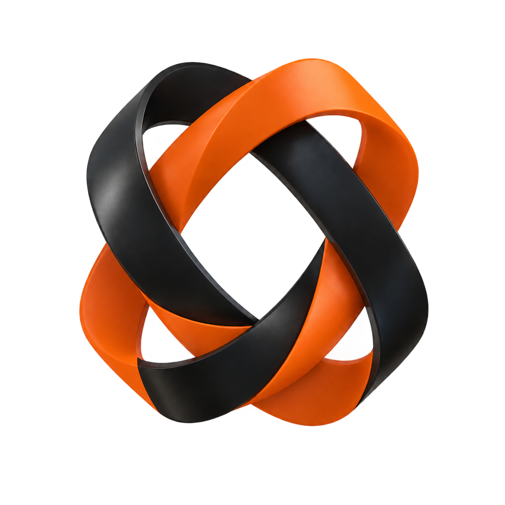

<div align="center">

</div>

# oxide-fw-cli

**The `oxide` command-line tool.**

[](https://crates.io/crates/oxide-fw-cli) [](https://crates.io/crates/oxide-fw-cli) [](https://docs.rs/oxide-fw-cli) [](https://github.com/elcoosp/oxide#rust-version)
[](https://github.com/elcoosp/oxide#license) [](https://github.com/elcoosp/oxide/actions) [](https://crates.io/crates/oxide-fw-cli)

> **Note:** Part of [Oxide](https://github.com/elcoosp/oxide) — a framework-agnostic, full-stack meta-framework with a Rust core and TypeScript authoring.

## Overview

Everything the framework does at the operational level: dev server, production build, serve, checks, migrations, analysis, and health. The CLI is the orchestration layer — it builds the framework stack, wires the dispatchers, and runs the dev / build / serve loop.

## What it provides

The commands:

- **`oxide dev`** — dev server with HMR (CSS hot-swap, module reload, route-data updates)
- **`oxide build`** — production build (client + SSR + prerender + typegen; `--attest` adds `dist/build-id` + `dist/attest/`)
- **`oxide start`** — serve a built project (`oxide preview` serves the same build without a `--port` flag)
- **`oxide check`** — config validation, route scan, typecheck, lint, plugin diagnostics
- **`oxide routes`** — print the route table with render modes and L0 eligibility
- **`oxide analyze`** — per-route JS byte budget report
- **`oxide why`** — importers of a module (§13.4) or why a route is dynamic with OX-DYN reasons (`--route`)
- **`oxide migrate`** — codemod from Next / Nuxt / SvelteKit / Vite
- **`oxide doctor`** — environment and config health
- **`oxide add <pkg>`** — install and register an Oxide module
- **`oxide generate`** — scaffold a route / layout / action
- **`oxide test`** — gate on build manifests
- **`oxide audit`** — OSV advisory scan against package-lock.json
- **`oxide perf bisect`** — hunt the commit that regressed a metric (build-ms / client-js-bytes / ttfb-ms)
- **`oxide verify`** — check an attested build: canonical provenance, ed25519 signature (`--pubkey`), subject digests, the client-manifest integrity walk (`VRF-INTEGRITY`), `--rebuild`
- **`oxide schema`** — print the JSON Schema for `oxide.config.ts`
- **`oxide docs generate`** — write `docs/reference/` from the linked crates (§18 matrix, config schema, CLI tree, error registry); `--check` is the CI docs gate
- **`oxide mcp`** — MCP server over stdio
- **`oxide render`** — render one route to HTML, bypass the server
- **`oxide config`** — print the loaded config as JSON
- **`oxide cache`** — inspect, clear, stats, gc
- **`oxide secrets`** — rotate the build secret

## Usage

```bash
oxide dev
oxide build --attest
oxide start --port 3000
OXIDE_CHECK_STRICT=1 oxide check
```

Every command is also a public `cmd_*` function — tests and tooling can call them directly.

## Observability

The serve boot wires the §20 cache-plane exposition into `/_oxide/metrics`: the boot's `MetricsCacheObserver` renders the `oxide_cache_plane_*` counter families, the hot-key attribution ledger (`oxide_fw_cache::HotKeyObserver`) renders the labeled `oxide_cache_plane_hot_key_total` family over the resolved top window, and — behind the operator's opt-in — the ledger's coverage exposition (the unattributed score's counter, the occupancy and bound gauges). The window and the opt-in speak one layered precedence: the boot flag wins (`--cache-hot-key-top N`, `--cache-plane-coverage`), then the env spelling (`OXIDE_CACHE_PLANE_HOT_KEY_TOP`, `OXIDE_CACHE_PLANE_COVERAGE`), then the committed baseline (`cache.hotKeyTop`, `cache.coverageMetrics`), then the documented defaults (window 10, coverage off — the default scrape shape stays byte-identical). Since F47/F48 the tier's own posture rides the same scrape: the F32 pull (`TieredCache::health()` → `CacheHealth::render_prometheus()`, the nine `oxide_cache_plane_*` gauge families) composes after the labeled and coverage families behind its own opt-in — the `--cache-plane-health` boot flag wins, then the `OXIDE_CACHE_PLANE_HEALTH` env spelling, then the `cache.healthMetrics` committed baseline, through the layered `observability::cache_plane_health_with_config` resolver (public API with a doctest, beside the other two). The resolvers (`observability::cache_hot_key_top_with_config`, `observability::cache_plane_coverage_with_config`, `observability::cache_plane_health_with_config`) are public API with doctests; the parse cores are pure and the boot resolves them once, pre-runtime (the override slots `apply_startup_env` writes are command-level facts, never a mid-async env poll).

Since F49 the same opt-in feeds the posture pull's second production surface: `GET /-/health` answers the posture as JSON — the server crate's cache-agnostic `CachePosture` seam (`crates/server/src/lib.rs`) adapted by the CLI's `TierCachePosture` over the boot's captured typed tier, wired through `posture_probe_provider` when BOTH halves hold (the resolved opt-in and the tier handle; the default boot 404s "not configured", nothing leaks). The public wire body is `cache_posture_probe_json`; `crates/cli/examples/posture_probe.rs` walks the gate, the adapter, the wire body and the server arm in one run.

## How it fits in Oxide

The CLI is the only crate that sees the whole framework stack. It builds the renderer, the loader, the action dispatcher, the endpoint dispatcher, and the middleware dispatcher — then hands them to `oxide-fw-server` as trait objects. Everything else is library code that the CLI wires together.

## See also

- [`oxide-fw-server`](https://crates.io/crates/oxide-fw-server) — the HTTP pipeline the CLI runs
- [`oxide-fw-dev`](https://crates.io/crates/oxide-fw-dev) — HMR and file watching
- [`oxide-fw-config`](https://crates.io/crates/oxide-fw-config) — config loading

---

Full API reference: [docs.rs/oxide-fw-cli](https://docs.rs/oxide-fw-cli)
