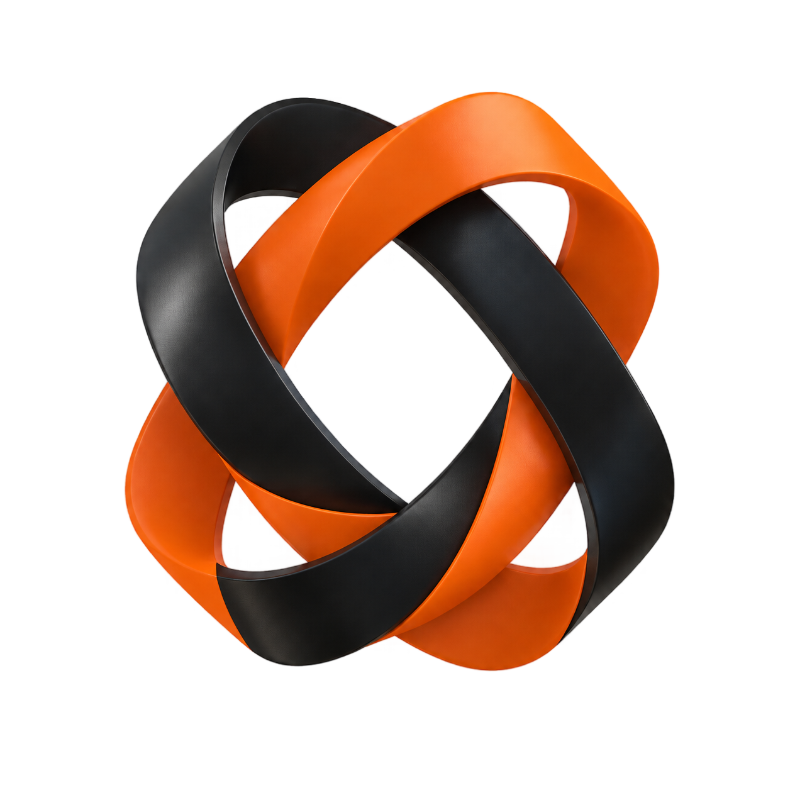

<div align="center">

</div>

# oxide-fw-config

**TypeScript config loading, extraction, and schema validation.**

[](https://crates.io/crates/oxide-fw-config) [](https://crates.io/crates/oxide-fw-config) [](https://docs.rs/oxide-fw-config) [](https://github.com/elcoosp/oxide#rust-version)
[](https://github.com/elcoosp/oxide#license) [](https://github.com/elcoosp/oxide/actions) [](https://crates.io/crates/oxide-fw-config)

> **Note:** Part of [Oxide](https://github.com/elcoosp/oxide) — a framework-agnostic, full-stack meta-framework with a Rust core and TypeScript authoring.

## Overview

Oxide's configuration is `oxide.config.ts` — a real TypeScript file, not a JSON subset. This crate evaluates it, extracts what it can statically, validates the result against a JSON Schema, and hands a strongly-typed `OxideConfig` to the rest of the framework.

The file is loaded by a Node worker (the "framework host") that imports the module, runs the user's `createAdapter(...)` factory if present, and returns a serialized descriptor. A static extractor fast-paths the literal-object case.

## What it provides

- **`load(dir, mode, cli_overrides)`** — full config load: layered resolution (`defaults → extends presets → oxide.config.{ts,json} → mode file → OXIDE_* env → CLI flags`) with typo-suggestion validation
- **`load_with_env`** — the same layering with an injectable process-env map (the test seam)
- **Static extraction** — `extract_static_config` fast-paths literal-object configs (D14); dynamic configs fall back to the framework host
- **`OxideConfig`** — the typed view: `framework`, `routes`, `server`, `cache`, `security`, `i18n`, `plugins`, `modules`, `budgets`, `adapter`, `search` (V2-F09's surface), …
- **`config_schema_pretty()`** — JSON Schema for editor autocomplete
- **`parse_size`** — human-readable sizes (`"512mb"`, `"64kb"`) with overflow checks
- **`parse_env_file`** — dotenv-compatible `.env` parsing
- **`feature_report(facts)`** — the §18 config-key refusal mapping (V2-R02's config half): this config's keys plus the driver's `ProjectFacts` (live routes, `*.server.rs` presence, non-static routes) as the adapters crate's `ConfigFeatureReport`, so `check_config` can refuse what the target cannot honor. The config-KEY surfaces are `fonts.subset: ['used']` (C08) and `search.collections` (V2-F09 — `AST-SRC-001` on a target without the Search capability); see `examples/feature_report.rs` for the walkthrough

## Usage

```rust,ignore
use oxide_fw_config::load;
use std::collections::BTreeMap;

let loaded = load(&root, "production", BTreeMap::new())?;
println!("framework adapter: {:?}", loaded.config.framework.adapter);
```

> **Tip:** Add `"$schema": "https://oxide.dev/config.schema.json"` to your `oxide.config.json` (or an editor setting for `.ts`) to get full autocomplete and inline docs in VS Code.

## How it fits in Oxide

Every `oxide` command loads the config first. `oxide-fw-cli` calls `load` (or `load_config_or_default` for commands that tolerate a missing config). The framework stack, route scanner, bundler, and server all read from the typed `OxideConfig` — none of them re-parse `oxide.config.ts` themselves.

## See also

- [`oxide-fw-cli`](https://crates.io/crates/oxide-fw-cli) — the primary consumer
- [`oxide-fw-server`](https://crates.io/crates/oxide-fw-server) — reads `security`, `cache`, `server` fields
- [`oxide-fw-assets`](https://crates.io/crates/oxide-fw-assets) — reads `i18n`, `images`, `fonts`

---

Full API reference: [docs.rs/oxide-fw-config](https://docs.rs/oxide-fw-config)
